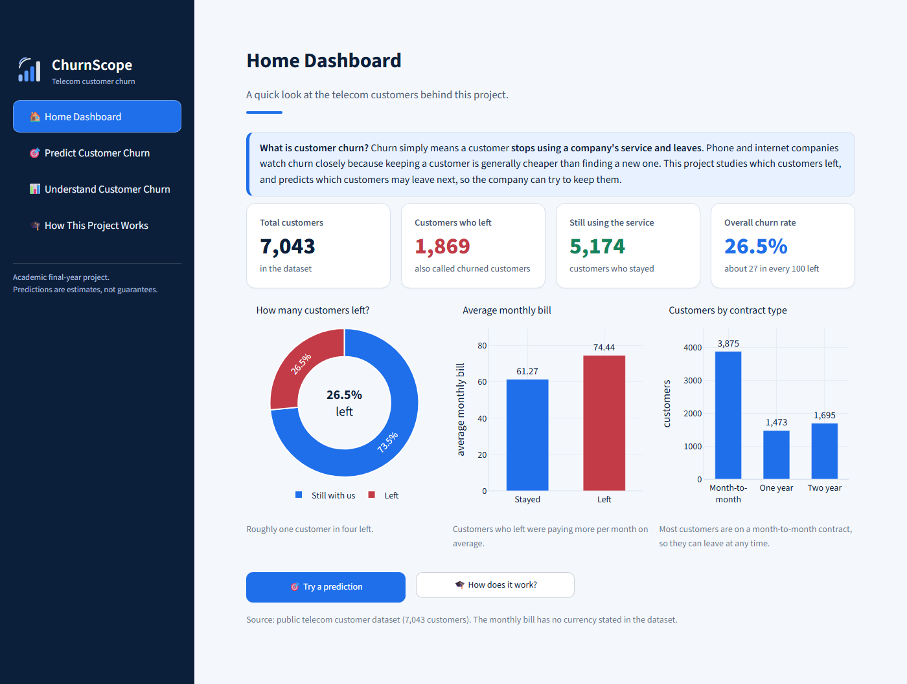
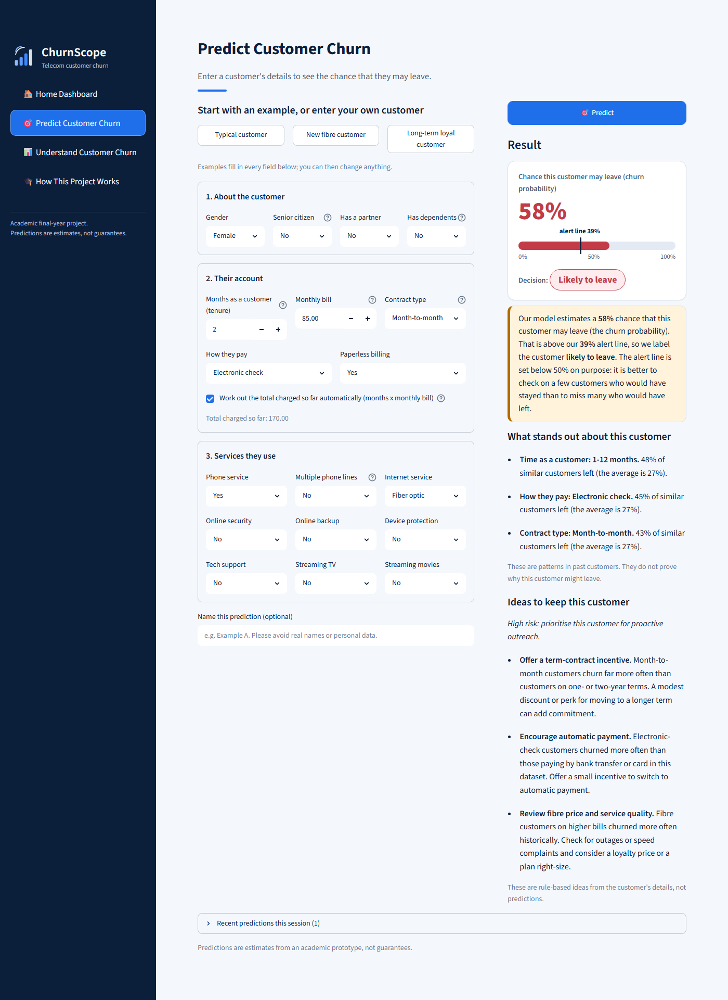
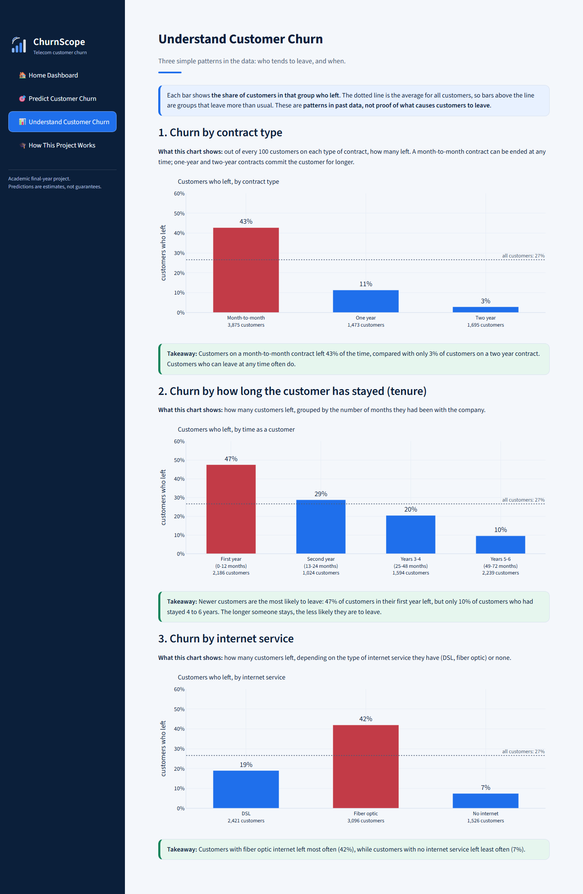
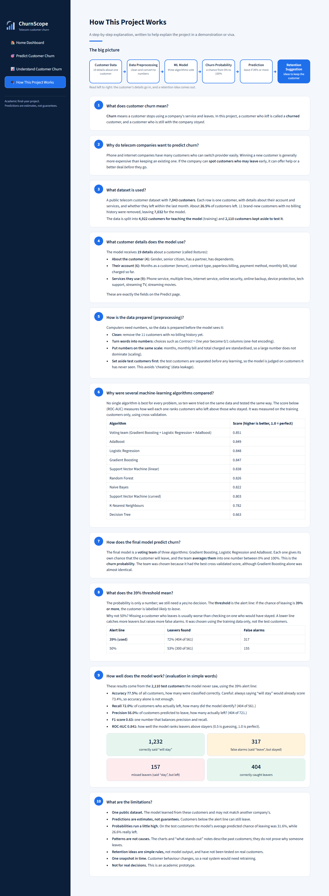
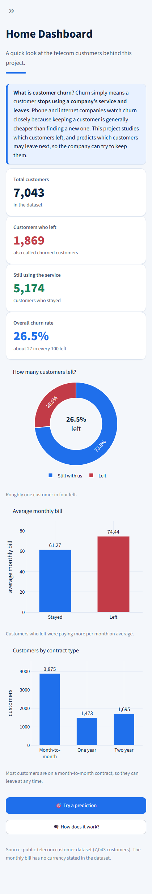
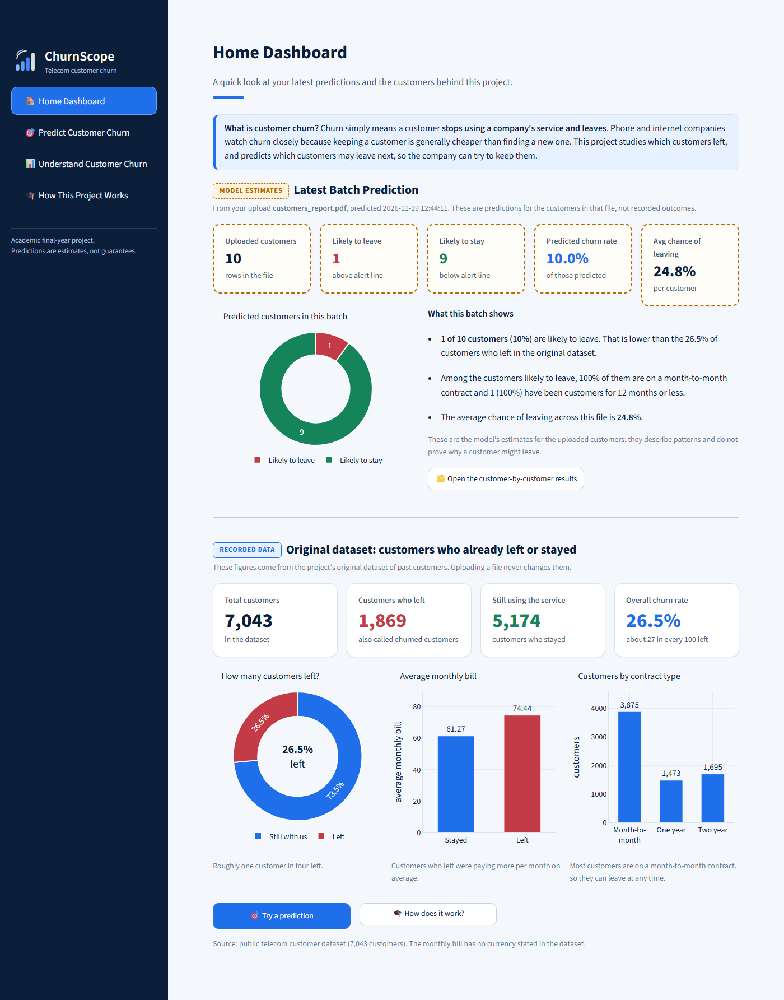
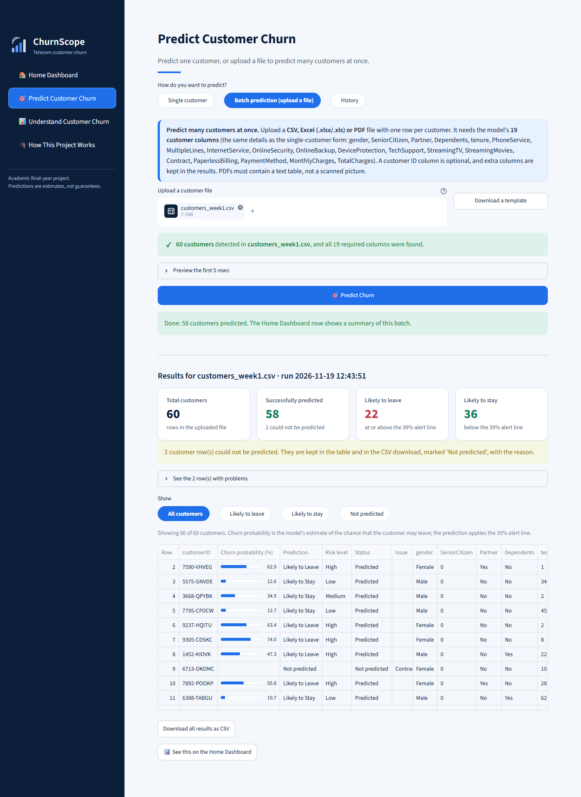
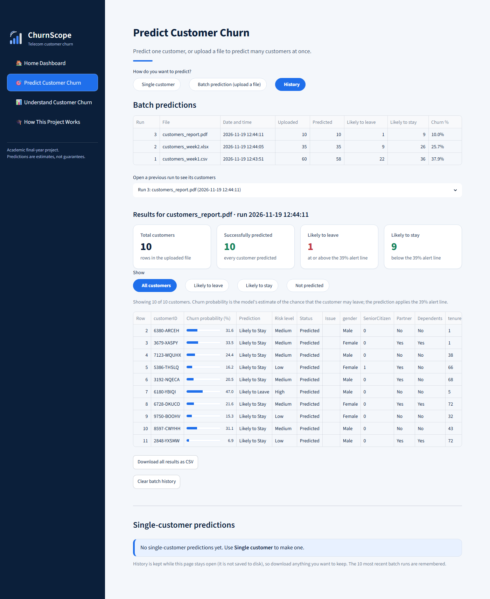

<div align="right">
  
[1]: https://github.com/Pradnya1208
[2]: https://www.linkedin.com/in/pradnya-patil-b049161ba/
[3]: https://public.tableau.com/app/profile/pradnya.patil3254#!/
[4]: https://twitter.com/Pradnya1208


[][1]
[][2]
[.svg)][3]
[][4]

</div>


# <div align="center">Telecom Customer Churn Prediction</div>


## What is Customer Churn?
Customer churn is defined as when customers or subscribers discontinue doing business with a firm or service.

Customers in the telecom industry can choose from a variety of service providers and actively switch from one to the next. The telecommunications business has an annual churn rate of 15-25 percent in this highly competitive market.

Individualized customer retention is tough because most firms have a large number of customers and can't afford to devote much time to each of them. The costs would be too great, outweighing the additional revenue. However, if a corporation could forecast which customers are likely to leave ahead of time, it could focus customer retention efforts only on these "high risk" clients. The ultimate goal is to expand its coverage area and retrieve more customers loyalty. The core to succeed in this market lies in the customer itself.

Customer churn is a critical metric because it is much less expensive to retain existing customers than it is to acquire new customers.

To detect early signs of potential churn, one must first develop a holistic view of the customers and their interactions across numerous channels.As a result, by addressing churn, these businesses may not only preserve their market position, but also grow and thrive. More customers they have in their network, the lower the cost of initiation and the larger the profit. As a result, the company's key focus for success is reducing client attrition and implementing effective retention strategy.
## Objectives:
- Finding the % of Churn Customers and customers that keep in with the active services.
- Analysing the data in terms of various features responsible for customer Churn
- Finding a most suited machine learning model for correct classification of Churn and non churn customers.

## Dataset:
 [Telco Customer Churn](https://www.kaggle.com/bhartiprasad17/customer-churn-prediction/data)

### The data set includes information about:

- Customers who left within the last month – the column is called Churn
- Services that each customer has signed up for – phone, multiple lines, internet, online security, online backup, device protection, tech support, and streaming TV and movies
- Customer account information – how long they’ve been a customer, contract, payment method, paperless billing, monthly charges, and total charges
- Demographic info about customers – gender, age range, and if they have partners and dependents
## Implementation:

**Libraries:** sklearn, Matplotlib, pandas, seaborn, and NumPy


## Few glimpses of EDA:
### 1. Churn distribution:

> 
> 26.6 % of customers switched to another firm.

### 2. Churn distribution with respect to gender:
> 


> There is negligible difference in customer percentage/count who chnaged the service provider. Both genders behaved in similar fashion when it comes to migrating to another service provider/firm.`

### 3. Customer Contract distribution:
> 
> 42.7% of customers with a Month-to-Month contract churned, compared with 11.3% on a One Year contract and 2.8% on a Two Year contract (computed directly from `data.csv`).

### 4. Payment Methods:
>  

> Major customers who moved out were having Electronic Check as Payment Method.
> Customers who opted for Credit-Card automatic transfer or Bank Automatic Transfer and Mailed Check as Payment Method were less likely to move out.

### 5. Internet services:

> Several customers choose the Fiber optic service and it's also evident that the customers who use Fiber optic have high churn rate, this might suggest a dissatisfaction with this type of internet service.
> Customers having DSL service are majority in number and have less churn rate compared to Fibre optic service.


### 6. Dependent distribution:

> Customers without dependents are more likely to churn.


### 7. Online Security:

> As shown in following graph, most customers churn due to lack of online security


### 8. Senior Citizen:

> Most of the senior citizens churn; the number of senior citizens are very less in over all customer base.


### 9. Paperless Billing:

> Customers with Paperless Billing are most likely to churn.


### 10. Tech support:

> As shown in following chart, customers with no TechSupport are most likely to migrate to another service provider.


### 11. Distribution w.r.t Charges and Tenure:
> 
> 
> 

> Customers with higher Monthly Charges are also more likely to churn.<br>
> New customers are more likely to churn.

## Machine Learning Pipeline (reproducible, leak-free)

The modelling code lives in `Scripts/churn_pipeline.py` (functions) and `Scripts/train_churn_model.py` (end-to-end run). It replaces the modelling cells of the original notebook, which had train/test leakage and unseeded models (the notebook is kept for its EDA).

```
pip install -r requirements.txt
python Scripts/train_churn_model.py      # ~2 minutes; writes reports/ and models/
python -m pytest tests                   # fast correctness tests
```

**What the pipeline does**

1. Cleaning (row-wise only): drops `customerID` and the 11 customers with `tenure = 0` (blank `TotalCharges`, never billed). 7,032 rows remain.
2. Stratified 70/30 split (`random_state=42`) **before** anything is fitted: 4,922 train / 2,110 test.
3. One `ColumnTransformer` + `Pipeline`: `StandardScaler` on `tenure`, `MonthlyCharges`, `TotalCharges`; `OneHotEncoder` (unseen categories ignored) on the 16 categorical columns. The original notebook label-encoded nominal columns and re-fitted the scaler on the test set; both are fixed.
4. The 10 original models are compared by repeated stratified 5-fold CV **on the training split**, with the whole pipeline refitted in every fold. All models are seeded.
5. Logistic Regression, KNN, Random Forest, AdaBoost and Gradient Boosting are tuned with `GridSearchCV` (5-fold, ROC-AUC, training split only). This replaces choosing KNN's `k` and the forest size from test-set accuracy. A soft-voting ensemble of the tuned Gradient Boosting, Logistic Regression and AdaBoost is added.
6. The final model is chosen by CV ROC-AUC, fitted on the training split, and evaluated **once** on the untouched test split.

No resampling (SMOTE), class weights or feature selection are used. Models are trained on the natural 26.6% churn rate.

**Results** (from the actual run; `reports/metrics.json`, `reports/model_comparison_cv.csv`)

Baseline CV on the training split (mean of 10 folds, default hyper-parameters):

| Model | ROC-AUC | Accuracy | Precision | Recall | F1 |
|---|---|---|---|---|---|
| Voting (GB+LR+AdaBoost) | 0.851 | 0.808 | 0.669 | 0.551 | 0.604 |
| AdaBoost | 0.849 | 0.799 | 0.651 | 0.528 | 0.583 |
| Logistic Regression | 0.848 | 0.802 | 0.650 | 0.554 | 0.598 |
| Gradient Boosting | 0.847 | 0.802 | 0.657 | 0.531 | 0.587 |
| SVC (linear) | 0.838 | 0.800 | 0.649 | 0.541 | 0.589 |
| Random Forest | 0.826 | 0.791 | 0.638 | 0.491 | 0.555 |
| Gaussian NB | 0.822 | 0.699 | 0.464 | 0.851 | 0.600 |
| Kernel SVM (rbf) | 0.803 | 0.801 | 0.672 | 0.492 | 0.567 |
| KNN (k=5) | 0.782 | 0.762 | 0.555 | 0.531 | 0.542 |
| Decision Tree | 0.663 | 0.734 | 0.501 | 0.512 | 0.506 |

After tuning (CV ROC-AUC, training split): Gradient Boosting 0.853, tuned Voting 0.853, AdaBoost 0.851, Random Forest 0.850, Logistic Regression 0.848, KNN 0.836. **Near-tie:** tuned soft-voting (0.8527) beat tuned Gradient Boosting (0.8526) by 0.0001 CV ROC-AUC, while the fold-to-fold standard deviation is about 0.011. That difference is not meaningful: the two are statistically indistinguishable, and Voting was selected only because the pre-set rule was "highest CV ROC-AUC". Gradient Boosting alone would be an equally valid, simpler choice. AdaBoost (0.851) and Random Forest (0.850) are within the same noise band.

**Final model (tuned soft-voting) on the untouched test set (2,110 customers):**

| Threshold | Accuracy | Precision | Recall | F1 | ROC-AUC | TN | FP | FN | TP |
|---|---|---|---|---|---|---|---|---|---|
| 0.50 (default) | 0.803 | 0.659 | 0.535 | 0.591 | 0.841 | 1394 | 155 | 261 | 300 |
| 0.39 (F1-optimal on out-of-fold training predictions) | 0.775 | 0.560 | 0.720 | 0.630 | 0.841 | 1232 | 317 | 157 | 404 |

Context: always predicting "no churn" scores 0.734 accuracy, so accuracy alone is a weak yardstick here; recall and ROC-AUC matter more. Lowering the threshold trades accuracy and precision for catching more churners (recall 0.53 to 0.72). The threshold was chosen without looking at the test set. `reports/confusion_matrix_test.png` shows both matrices.

**Reproducibility and limitations**

- Re-running the script gives byte-identical `reports/metrics.json` (verified on the same machine and library versions: Python 3.14, scikit-learn 1.9.0). Other library versions or platforms may differ slightly.
- Test-set metrics have sampling error (roughly ±1.7 points on accuracy with 2,110 rows); there is a single split, not repeated outer cross-validation.
- The CV score of the tuned voting model uses hyper-parameters picked on the same folds, so it is slightly optimistic; the test-set numbers above are the unbiased estimate.
- 22 duplicate customer rows (excluding ID) are kept. `TotalCharges` is nearly collinear with `tenure × MonthlyCharges`; no feature selection or VIF analysis is done.
- The figures in `output/` for models and metrics (e.g. `Model evaluation.PNG`, `confusion matrix.PNG`) come from the **old notebook** and are not produced by this pipeline.

The saved model is `models/churn_pipeline.joblib` (a dict with the fitted pipeline, the chosen threshold of 0.39 and the feature list). `predict_churn(load_model(), customer)` in `Scripts/churn_pipeline.py` scores raw customer rows and uses the saved threshold by default (override with `threshold=`; a bare pipeline falls back to 0.5).

## ChurnScope: a simple app to explore and predict customer churn

A local Streamlit app built on the saved model: no retraining, no backend, and nothing leaves your machine. It has four sections, chosen from the sidebar.



**Run it (Windows)**

```
pip install -r requirements.txt
python Scripts/train_churn_model.py      # once, creates models/ and reports/ (skip if they exist)
run_app.bat                              # or: python -m streamlit run app.py
```

Open http://localhost:8501 (the app listens on this machine only). If `python` on your PATH is not the interpreter that has the packages, set `CHURN_PYTHON=C:\path\to\python.exe` before `run_app.bat`.

**The four sections**

| Section | What it shows |
|---|---|
| **Home Dashboard** | A **Latest Batch Prediction** summary of your most recent upload (model estimates, updated automatically), kept apart from the **original dataset** figures: total customers (7,043), customers who left (1,869), customers still using the service (5,174), overall churn rate (26.5%), three simple charts and a short explanation of what churn means. |
| **Predict Customer Churn** | Three views: **Single customer** (a form with the model's 19 customer details in three groups, three example profiles and one **Predict** button, showing the *chance this customer may leave*, the decision at the saved **39% alert line**, a plain-English explanation, what stands out, and ideas to keep them), **Batch prediction (upload a file)** and **History**. |
| **Understand Customer Churn** | Three analyses (contract type, how long the customer has stayed, internet service), each with an explanation and a one-sentence takeaway. |
| **How This Project Works** | A ten-point walkthrough for a demonstration or viva: churn, why companies predict it, the dataset, the 19 features, preprocessing, the ten algorithms compared, the final voting model, the 39% threshold, the metrics in simple words, and the limitations, with a workflow diagram (Customer Data, Data Preprocessing, ML Model, Churn Probability, Prediction, Retention Suggestion). |

| Predict a customer | Understand churn |
|---|---|
|  |  |

| How it works | On a phone |
|---|---|
|  |  |

*Screenshots are of the real app with a made-up customer profile.*

**Batch prediction (many customers at once)**

On **Predict Customer Churn → Batch prediction**, upload a **CSV, Excel (.xlsx/.xls) or PDF** file with one row per customer (up to 10 MB and 10,000 customers). A template CSV can be downloaded from the page.

1. **Validate.** The 19 model columns are matched by name (case, spaces and underscores are ignored). A missing column stops the upload with a message naming it. An optional customer ID column and any extra columns are kept.
2. **Predict.** Press **Predict Churn**. Each valid customer is scored with the same saved model and 39% threshold as the single-customer form, and gets a churn probability (%), *Likely to Leave / Likely to Stay* and a risk level (Low, Medium, High).
3. **Read the results.** Summary cards (total, successfully predicted, likely to leave, likely to stay), a filterable customer table, and a CSV download with every uploaded column plus the predictions.
4. **Nothing is silently dropped.** A row that cannot be predicted (an unknown value such as `Contract = Weekly`, tenure outside 1 to 72, a blank or non-numeric charge, impossible service combinations) stays in the table and the CSV, marked *Not predicted* with the reason, and is listed in a "rows with problems" panel.

| Latest batch on the Home Dashboard | Batch results | History |
|---|---|---|
|  |  |  |

- **Home Dashboard:** after a successful batch it shows the latest batch summary (uploaded, likely to leave, likely to stay, predicted churn rate, average chance of leaving), a chart and plain-English findings, under a "Model estimates" label. The original dataset figures stay in their own "Recorded data" section and are never changed by uploads.
- **History** (inside the Predict page): every batch run (file name, date and time, uploaded, predicted, likely to leave, likely to stay, churn %), any earlier run can be opened and downloaded again, plus the single-customer predictions. History is kept in the browser session, so it survives page navigation and reruns but **not a browser refresh or closing the tab**; nothing is written to disk. The 10 most recent runs are kept.
- **File types:** CSV and `.xlsx` need no extra setup beyond `requirements.txt`. PDFs must contain a text table (not a scanned image). Spreadsheet formulas in uploaded text cells are neutralised in the downloaded CSV.

**Plain-English wording.** The app says "customers who left" for churn and "chance this customer may leave" for churn probability, and keeps the technical terms in brackets. For example, recall is explained as "of customers who actually left, how many did the model identify?" and precision as "of customers predicted to leave, how many actually left?".

**Things to know**

- The 39% alert line is the threshold saved with the model, chosen on training data. At 39% the model finds 72% of the customers who left (404 of 561 in the test set) with 317 false alarms; at 50% it would find 53% with 155 false alarms.
- "What stands out" notes and retention ideas are simple, rule-based and descriptive: they are patterns in past customers, not causes and not model output.
- Predictions are estimates from a prototype trained on one public dataset, not guarantees.
- `Scripts/churn_analytics.py` (segments, revenue and filter calculations, with tests) is kept as an analysis library but is no longer shown in the interface.

**Tests:** `python -m pytest tests` runs 195 checks covering the pipeline, validation, the 0.39 threshold boundary, the four app sections, batch prediction (CSV, Excel and PDF files, invalid files and rows, results, export, Home Dashboard updates and History), the analytics calculations (verified against the raw CSV) and the app itself (headless).

### Feedback

If you have any feedback, please reach out at pradnyapatil671@gmail.com


### 🚀 About Me
#### Hi, I'm Pradnya! 👋
I am an AI Enthusiast and  Data science & ML practitioner


[1]: https://github.com/Pradnya1208
[2]: https://www.linkedin.com/in/pradnya-patil-b049161ba/
[3]: https://public.tableau.com/app/profile/pradnya.patil3254#!/
[4]: https://twitter.com/Pradnya1208


[][1]
[][2]
[.svg)][3]
[][4]


